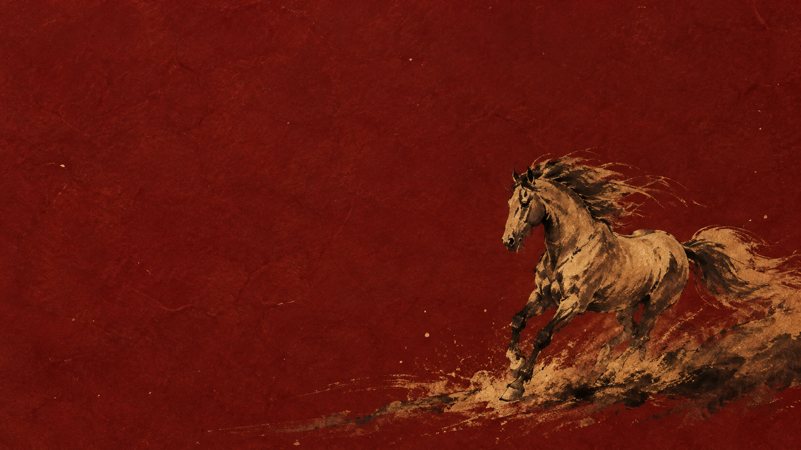
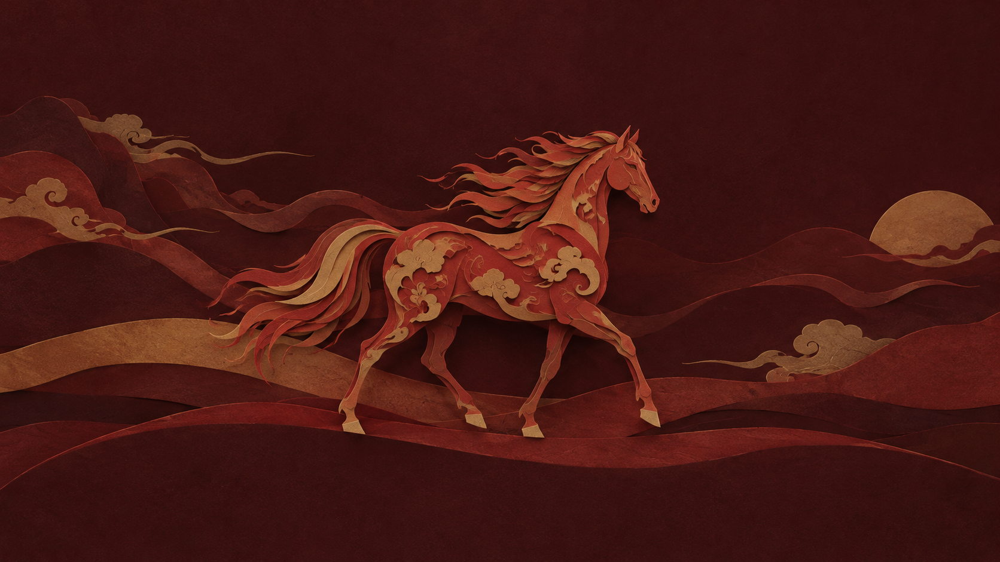
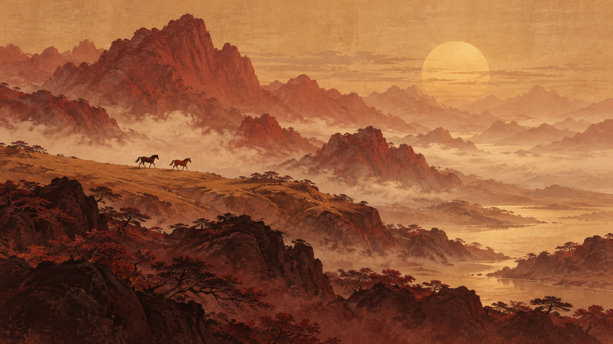

# Year of the Horse for Omarchy

A Chinese Year of the Horse theme with deep crimson surfaces, soft red highlights, pale yellow accents, and warm white text.



## Install

```sh
omarchy theme install https://github.com/dhh/omarchy-year-of-the-horse-theme
```

## Backgrounds

Three original wallpapers are included. Cycle through them with `omarchy theme bg next`.

### Ink Horse


### Paper Horse



### Mountain Horses



Wallpapers were generated with OpenAI image generation and are provided at their native resolution of 1672 × 941.

## Palette

| Color | Hex |
| --- | --- |
| Background | `#26151f` |
| Foreground | `#eee6e9` |
| Accent / yellow | `#e5ce78` |
| Red | `#df7087` |
| Selection | `#582c43` |

Omarchy generates application themes from `colors.toml`.

## License

MIT
